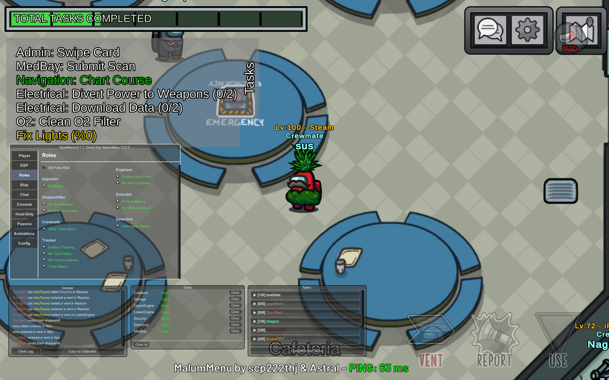

# NOTICE:
* KEWLMENU by omqItzrlyjames is a BepInEx mod menu for Among Us.
   * Original project: [soci-ety/SocietyMenu](https://github.com/soci-ety/SocietyMenu)
---
<p align="center">
  <b>An easy-to-use Among Us BepInEx plugin with a simple GUI and useful modules.</b>
</p>

<!-- omit in toc -->

---
# 😎 Table Of Contents

- [⬇️ Installation](#️-installation)
  - [🪟 Windows](#-windows)
  - [🔧 Building From Source](#-building-from-source)
  - [🐧 Linux](#-linux)
- [📋 Features](#-features)
- [❓ FAQ](#-faq)
- [⚠️ Disclaimer](#️-disclaimer)

# ⬇️ Installation

## 🪟 Windows

1. Install **BepInEx 6 IL2CPP x64** into your Among Us game folder.
   The folder must contain `Among Us.exe`, `winhttp.dll`, `doorstop_config.ini`, and `BepInEx\`.

2. Launch Among Us once, wait for BepInEx to finish creating its folders, then close the game.

3. Download `KEWLMENU.dll` and its dependencies JSON from the release page, or build them from source below.

4. Copy both files into:

   ```text
   Among Us\BepInEx\plugins\
   ```

5. Launch Among Us normally. Check `BepInEx\LogOutput.log` for the plugin load message.

6. Open the menu with the configured menu key. The default key is **DELETE**.

Do not install multiple KEWLMENU, HyperMenu, or legacy SocietyMenu DLLs at the same time. Remove older copies from `BepInEx\plugins\` first.

## 🔧 Building From Source

Requirements:

- Windows 11 or Windows 10
- .NET SDK 6 or newer
- Git
- Among Us `2026.8.18 / 17.5`
- BepInEx 6 IL2CPP installed in the game directory

Build from the repository root:

```powershell
dotnet restore .\SocietyMenu.sln
dotnet build .\SocietyMenu.sln --no-restore
```

The plugin files are generated in:

```text
bin\Debug\net6.0\KEWLMENU.dll
bin\Debug\net6.0\KEWLMENU.deps.json
```

Copy the generated plugin DLL, `.deps.json`, `NVorbis.dll`, `NAudio.dll`, `NAudio.Core.dll`, and `NAudio.WinMM.dll` into `Among Us\BepInEx\plugins\`.

## 🐧 Linux

1. Run Among Us under **Proton or Wine**.
   - In Steam, right-click Among Us → `Properties` → `Compatibility` → enable `Force the use of a specific Steam Play compatibility tool`.

2. Set up BepInEx for Proton/Wine using the official guide [here](https://docs.bepinex.dev/articles/advanced/proton_wine.html).

3. If BepInEx cannot load the IL2CPP chainloader, add this to the Steam launch options:

   ```text
   PROTON_NO_ESYNC=1 PROTON_USE_WINED3D=1 WINEDLLOVERRIDES="winhttp.dll=n,b" %command%
   ```

4. Follow the Windows plugin installation steps above.

# 📋 Features



## Changes from the original menu

- HyperMenu fork with additional modules and UI improvements
- Among Us 17.5 voting compatibility
- Updated MeetingHud and vote RPC handling for Among Us `2026.8.18`
- KEWLMENU by omqItzrlyjames watermark with stealth-mode support
- Configurable menu and chat colors
- Source build support for local BepInEx plugin installation

## OG Menu Features

- An intuitive GUI with gameplay and utility modules
- See ghosts and reveal impostors
- Track players using the minimap
- Teleport around the map
- Change roles
- Remove kill cooldowns and use kill utilities
- Unlock cosmetics locally
- Avoid disconnect penalties
- Meeting and voting utilities

For the original feature list, see [SocietyMenu FEATURES.md](https://github.com/scp222thj/SocietyMenu/blob/main/FEATURES.md).

# 💬 Community

Join the community Discord: [discord.gg/bH4Hy9YnVD](https://discord.gg/bH4Hy9YnVD)

# ❓ FAQ

Click to expand each topic.

<details>

<summary><h2>❗ KEWLMENU does not load</h2></summary>

Make sure you installed **BepInEx 6 IL2CPP x64**, not BepInEx 5. Confirm that `winhttp.dll` and `doorstop_config.ini` are beside `Among Us.exe`, then launch the game once before copying the plugin files.

Check `BepInEx\LogOutput.log` for errors. The plugin should be installed only once in `BepInEx\plugins\`.

The current build targets Among Us `17.5 / 2026.8.18`. Older or newer game versions may require a different build.

</details>

<details>

<summary><h2>👾 I found a bug or want to suggest a feature</h2></summary>

Open an issue on the [repository](https://github.com/soci-ety/SocietyMenu/issues). Include your Among Us version, BepInEx version, platform, and the relevant section of `BepInEx\LogOutput.log`.

</details>

# ⚠️ Disclaimer

KEWLMENU by omqItzrlyjames is not affiliated with Among Us or Innersloth LLC. The content contained herein is not endorsed or sponsored by Innersloth LLC. Portions of the materials used by this project are property of Innersloth LLC. © Innersloth LLC.

This plugin is provided for local testing and experimentation. Its use can violate the Among Us terms of service, interfere with other players, or result in temporary or permanent bans. Do not use it to disrupt public games, bypass protections, or negatively affect other users.

Use the software at your own risk. The authors are not responsible for account action, game instability, data loss, or other consequences resulting from its use.